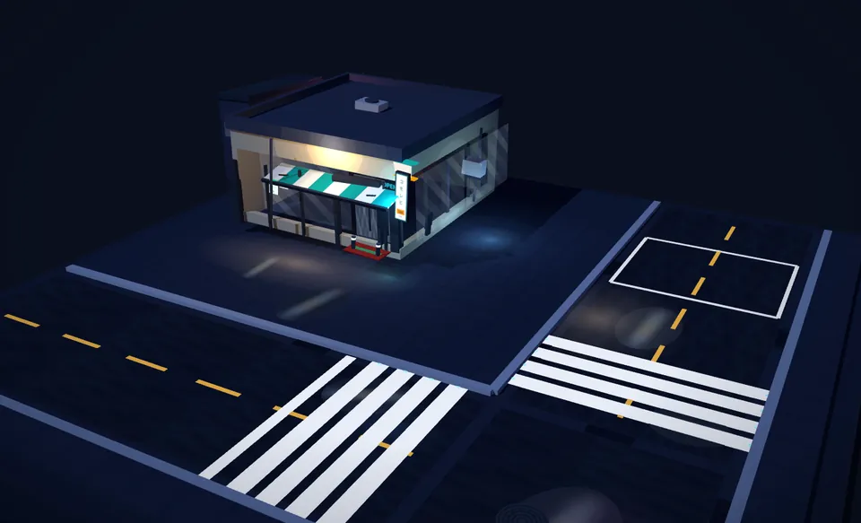
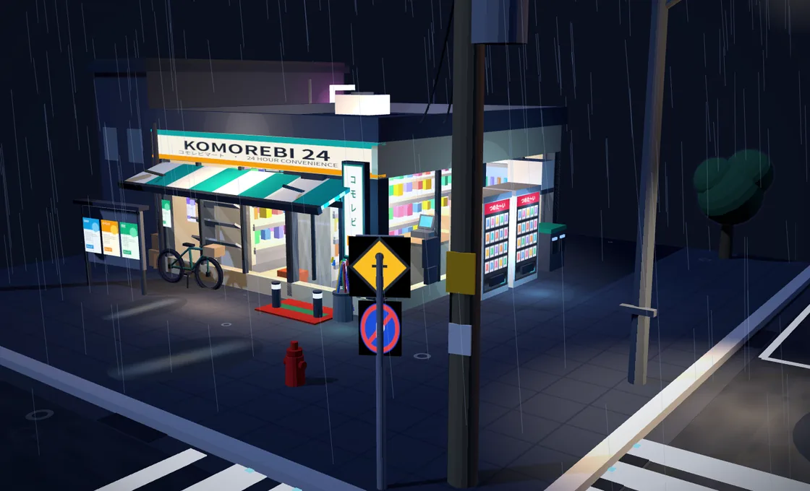

<div align="center">

# 雨夜日式便利店街角 · Rainy Konbini Diorama

**基于 Three.js + Vite 的三渲二（Cel-Shading）雨夜街角微缩景观体验**

[](https://ada20204.github.io/rainy-konbini-diorama/)
[](https://github.com/ada20204/rainy-konbini-diorama/actions/workflows/ci.yml)
[](https://github.com/ada20204/rainy-konbini-diorama/actions/workflows/deploy-pages.yml)
[](https://threejs.org/)
[](./LICENSE)

[在线预览 (GitHub Pages)](https://ada20204.github.io/rainy-konbini-diorama/) · [快速开始](#快速开始) · [场景内容](#场景内容) · [工程架构](#工程架构)

<br />


</div>

---

## 视觉亮点与入场装配

零 UI 干扰的第三视角自由环绕场景：打开页面后模型自底座起分层弹出落位（底座 → 路面 → 便利店 → 店内陈设 → 街具 → 悬垂电线 → 细雨与积水涟漪，全长约 `11.4s`），在夜间冷月光与店内琥珀暖光间建立层次对比。

<table>
  <tr>
    <td width="50%" align="center">
      
      <br />
      <sub><strong>分层装配过程（约 5s）</strong> — 底座路面先展开，商店与橱窗顺次弹出归位</sub>
    </td>
    <td width="50%" align="center">
      
      <br />
      <sub><strong>街角路网与雨夜倒影</strong> — 湿滑沥青反光、积水波纹与反光安全护栏</sub>
    </td>
  </tr>
</table>

<p align="center">
  
  <br />
  <sub><strong>店门前近景</strong> — <code>KOMOREBI 24</code> 招牌微闪、雨伞架、海报栏、自动贩卖机及通透室内收银台与货架</sub>
</p>

---

## 核心技术特性

- **三渲二材质与无裂缝描边（[toon.js](./src/core/toon.js)）**：采用 `MeshToonMaterial` + 8 级阶梯渐变贴图（前 4 级归零以隔绝室内点光源向屋顶背光面漏光），配合合并顶点平滑法线外扩（`mergeVertices`）的反向壳描边（inverted hull），确保硬边体块转角不裂边。
- **全 Canvas 程序化纹理（[textures.js](./src/core/textures.js)）**：招牌字体、垂直灯箱、自动贩卖机饮品矩阵、公告海报、交通标志、玻璃高光、斑马线与湿沥青贴图全部通过 Canvas 2D 离线生成，零外部 CDN 依赖。
- **轻量高性能雨夜渲染（[rain.js](./src/core/rain.js) & [buildScene.js](./src/scene/buildScene.js)）**：`1,700` 条 `LineSegments` 雨丝自动规避商店与邻楼遮挡区，搭配地面溅落涟漪；货架商品与饮料瓶采用 `InstancedMesh` 合批，仅主月光投射阴影。
- **纯交互微缩视角（[main.js](./src/main.js)）**：左键拖拽旋转、滚轮缩放、右键平移；进入页面开启轻缓自动旋转，用户开始拖拽时自动暂停以免打断构图。

---

## 场景内容

| 类别           | 元素                                                                                                                                                 |
| :------------- | :--------------------------------------------------------------------------------------------------------------------------------------------------- |
| **便利店主体** | 发光横招（`KOMOREBI 24`）、竖式悬挂招牌、`OPEN` 灯箱、绿白条纹雨棚、大面积玻璃橱窗、自动门、红绿门垫、护柱、空调外机、落水管、电表箱                 |
| **店内陈设**   | `InstancedMesh` 双排货架商品、后墙玻璃冷柜（饮料）、收银台 + 收银机 + 咖啡机 + 热食柜、悬挂菜单、杂志架、天花板灯盘、海报与购物篮                    |
| **街角设施**   | 自动贩卖机 ×2、自行车、雨伞架、分类垃圾桶、木质电线杆 ×2 + 悬垂电线、路灯、行人/禁停路牌、街角护栏、消防栓、公告栏、井盖、排水沟格栅、停车位、斑马线 |
| **氛围环境**   | 左侧邻楼（小巷、墙面管线、巷灯、霓虹灯条）、屋顶空调、行道树、冷暖双色光影、动态雨丝、积水霓虹倒影与招牌微闪                                         |

---

## 快速开始

### 环境要求

- **Node.js** `>= 20.0.0`（已验证 `v22.22.3`）
- **npm** `>= 10`

### 安装与运行

```bash
git clone https://github.com/ada20204/rainy-konbini-diorama.git
cd rainy-konbini-diorama
npm install
npm run dev
```

### 常用工程命令

| 命令                     | 用途                                                                               |
| :----------------------- | :--------------------------------------------------------------------------------- |
| `npm run dev`            | 启动 Vite 开发服务器（`127.0.0.1:4175`）                                           |
| `npm run lint`           | 运行 ESLint 静态检查                                                               |
| `npm run format:check`   | 检查 Prettier 代码格式规范                                                         |
| `npm run build`          | 按默认 `/konbini/` 基础路径构建到 `dist/`（可通过 `.env` / `VITE_BASE_PATH` 覆盖） |
| `npm run build:root`     | 以根路径 `/` 构建生产产物（适合独立域名自托管）                                    |
| `npm run build:gh-pages` | 以 `/rainy-konbini-diorama/` 构建 GitHub Pages 产物                                |
| `npm run check`          | 串行执行 `lint` + `format:check` + `build` 全量门禁                                |
| `npm run verify:e2e`     | 拉起 `vite preview` 并使用无头 Firefox + `geckodriver` 执行全流程端到端验证        |

### 子路径部署（可选）

项目通过 `VITE_BASE_PATH`（参见 [`.env.example`](./.env.example)）与 `subpathProxyCompatPlugin`（参见 [`vite.config.js`](./vite.config.js)）同时支持根路径、GitHub Pages 以及任意反向代理子路径（带或不带结尾 `/` 均可正常解析静态资源）：

```bash
# 示例：挂到反向代理 /konbini/ 子路径
VITE_BASE_PATH=/konbini/ npm run build
npm run preview -- --port 4175 --host 127.0.0.1
```

---

## 工程架构

```text
rainy-konbini-diorama/
├── .github/workflows/
│   ├── ci.yml                  # PR 与 main 推送触发 lint + format + build 检查
│   └── deploy-pages.yml        # main 推送自动质量校验并发布到 GitHub Pages
├── assets/readme/              # README 展示用精选 WebP 实拍截图
├── scripts/
│   └── verify-e2e.mjs          # 无头 Firefox + geckodriver 自动化端到端验证脚本
├── src/
│   ├── core/
│   │   ├── assembly.js         # 零件分层入场动画控制器（总时长约 11.4s）
│   │   ├── lights.js           # 夜间冷色半球光与主投影月光设置
│   │   ├── rain.js             # 雨丝线段粒子与地面溅落涟漪系统
│   │   ├── textures.js         # Canvas 2D 程序化街景/店招/贩卖机贴图工厂
│   │   └── toon.js             # 8 级 toon 材质、反向壳描边与确定性随机工具
│   ├── scene/
│   │   ├── base.js             # 正方形街角底座、沥青马路、斑马线与积水贴花
│   │   ├── buildScene.js       # 场景总装、雨势启动时序与招牌微闪更新
│   │   ├── layout.js           # 底座、路网、商店与邻楼共享布局常量
│   │   ├── props.js            # 贩卖机、电线杆、护栏、路灯与小巷道具
│   │   └── store.js            # KOMOREBI 24 便利店外壳、橱窗及店内陈设
│   └── main.js                 # WebGLRenderer、OrbitControls 与主渲染循环
├── .editorconfig
├── .env.example                # VITE_BASE_PATH 基础路径配置示例
├── .prettierrc.json
├── eslint.config.mjs
├── index.html
├── LICENSE
├── package.json
└── vite.config.js              # 环境变量化 base、子路径代理兼容与 Rolldown 分包
```

---

## 实测结果与已知边界

- **分包构建（`npm run check` / Vite `8.3.8`）**：借助 `build.rolldownOptions.output.codeSplitting`，业务代码打包为 `index-*.js`（`37.02 kB`，gzip `13.75 kB`），`Three.js` 运行时独立拆分为 `vendor-three-*.js`（`764.36 kB`，gzip `192.32 kB`）以便浏览器长效缓存。
- **自动化验证（`npm run verify:e2e`，无头 Firefox WebGL）**：`errors: []`、`total: 11.362s`（全阶段完成装配与降雨）、`meshCount: 472`、`lightCount: 13`、`calls: 802`、`triangles: 32,538`、`dragDelta: 28.315`、`zoomDistanceDelta: 4.199`、`autoRotateStoppedOnDrag: true`、窄屏视口 `overflowX: false` 且画布宽度与视口自适应对齐。
- **已知边界**：自动化浏览器检查在无头桌面 Firefox（SwiftShader 软渲染，窄屏窗口最小宽度受桌面浏览器限制为 `500px`）下完成，尚未在移动端真机实测触控拖拽手感与硬件 GPU 帧率。

本项目基于 [MIT License](./LICENSE) 开源。
